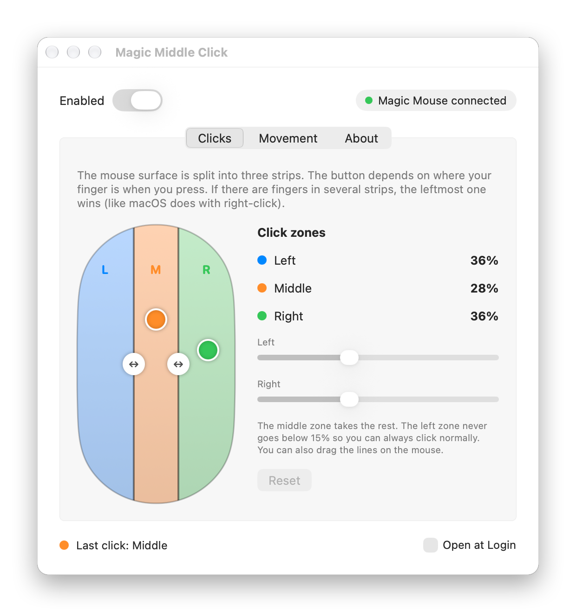
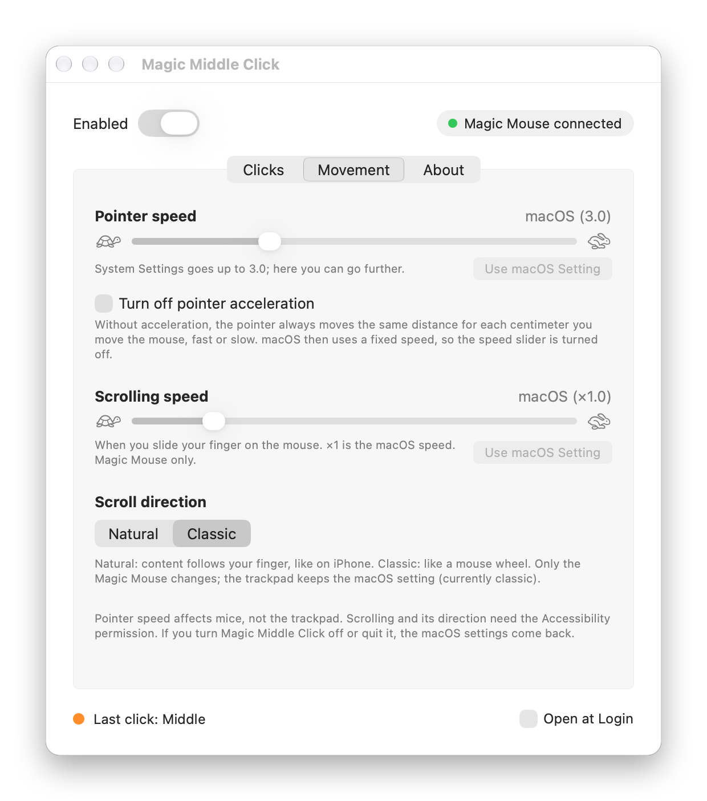
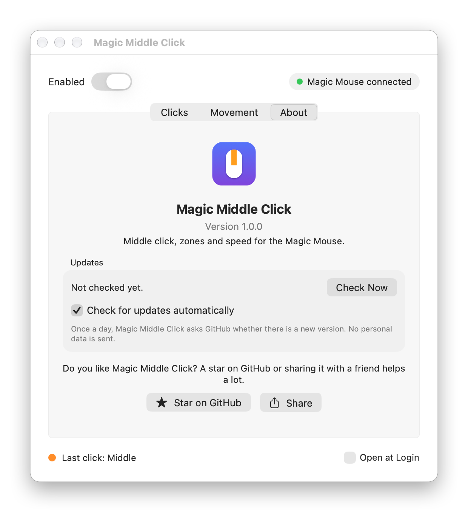

<p align="center">
  
</p>

<h1 align="center">Magic Middle Click — Middle Click for the Apple Magic Mouse on Mac</h1>

<p align="center">
  <strong>Add a middle click to your Apple Magic Mouse</strong>, choose how wide the left, middle and right click zones are,<br>
  make the pointer faster than macOS allows, turn off mouse acceleration, and set scroll speed and direction just for the mouse.
</p>

<p align="center">
  <a href="https://github.com/gonzaroman/magic-middle-click/releases/latest/download/MagicMiddleClick.dmg"><strong>⬇ Download Magic Middle Click for macOS</strong></a>
  &nbsp;·&nbsp; Free &nbsp;·&nbsp; macOS 13 or later &nbsp;·&nbsp; Apple Silicon and Intel
</p>

<p align="center">
  <a href="https://github.com/gonzaroman/magic-middle-click/releases/latest"></a>
  
  <a href="LICENSE"></a>
</p>

<p align="center">
  <picture>
    <source media="(prefers-color-scheme: dark)" srcset="docs/screenshots/clicks-dark.png">
    
  </picture>
</p>

The Apple Magic Mouse has no middle button, and macOS has no setting to add one. **Magic Middle Click** reads where your fingers are on the Magic Mouse touch surface and turns each click into a **left, middle or right click** depending on the zone. You can then do everything a middle mouse button does:

- open links in a new tab and close tabs with a middle click (Safari, Chrome, Firefox, Arc…);
- paste in Terminal and other X11-style apps;
- orbit and pan in Blender, CAD and 3D software;
- use the middle button in games, IDEs and any app that supports it.

## Features

- **Middle click for the Magic Mouse** with three click zones: left, middle and right.
- **Adjustable zones.** Drag the lines on the mouse drawing or use the sliders. The default is 36% / 28% / 36%, and the left zone never goes below 15%, so normal clicking always works.
- **Live finger view.** See your fingers on the mouse and which zone each one would click.
- **Pointer speed beyond the macOS maximum**, from 0 to 10. System Settings stops at 3.
- **Turn off mouse acceleration**: the pointer moves the same distance for the same hand movement, at a fixed speed.
- **Magic Mouse scrolling speed**, from ×0.2 to ×5.
- **Natural or classic scrolling for the mouse only.** Keep natural scrolling on the trackpad and classic scrolling on the Magic Mouse, or the other way round. macOS normally forces one setting for both.
- **Update notifications** when a new version is released, plus *Check for Updates…* in the menu.
- **10 languages:** English, Español, Deutsch, Français, Italiano, Português, Русский, 日本語, 简体中文 and 한국어. It follows your Mac's language.
- Lightweight menu bar app with no Dock icon. When you quit it or turn it off, your macOS settings come back.

<table>
  <tr>
    <td>
      <picture>
        <source media="(prefers-color-scheme: dark)" srcset="docs/screenshots/movement-dark.png">
        
      </picture>
    </td>
    <td>
      <picture>
        <source media="(prefers-color-scheme: dark)" srcset="docs/screenshots/about-dark.png">
        
      </picture>
    </td>
  </tr>
</table>

## Install

1. **[Download MagicMiddleClick.dmg](https://github.com/gonzaroman/magic-middle-click/releases/latest/download/MagicMiddleClick.dmg)**, open it and drag **Magic Middle Click** to **Applications**.
2. Open Magic Middle Click. The app isn't notarized by Apple yet, so macOS blocks it the first time:
   - Go to **System Settings → Privacy & Security** and click **Open Anyway** (it asks for your password).
   - On macOS 13 and 14 you can also right-click the app → **Open**. That shortcut no longer works from macOS 15 on.
   - Or, in Terminal: `xattr -dr com.apple.quarantine "/Applications/Magic Middle Click.app"`
3. Grant the **Accessibility** permission when asked (System Settings → Privacy & Security → Accessibility). It's needed to change clicks and scrolling.

A mouse icon appears in the menu bar. Open **Settings…** from there.

## FAQ

**How do I middle click on a Magic Mouse?**
Install Magic Middle Click and press with one finger in the middle zone of the mouse. That's the orange strip in the settings window, 28% of the width by default.

**Which Magic Mouse models does it work with?**
It's tested with the original Magic Mouse. Magic Mouse 2 and the USB‑C Magic Mouse use the same multitouch system, so they should work too. If you try one, please [tell us how it went](https://github.com/gonzaroman/magic-middle-click/issues).

**How do I turn off mouse acceleration on a Mac?**
Open Magic Middle Click → *Movement* → **Turn off pointer acceleration**. The pointer then always moves the same distance for each centimeter you move the mouse, at a fixed speed.

**Can I make my mouse faster than the macOS maximum?**
Yes. The *Pointer speed* slider goes up to 10; System Settings stops at 3.

**Can I use natural scrolling on the trackpad and classic scrolling on the mouse?**
Yes. Choose the Magic Mouse direction in *Movement → Scroll direction*. The trackpad keeps whatever macOS has.

**Does it change my trackpad?**
No. Pointer speed and acceleration only affect mice, and scroll speed and direction only apply when you scroll on the Magic Mouse.

**Why does it need the Accessibility permission?**
To change a click into a different button and to adjust scrolling, an app has to intercept mouse events, and macOS requires the Accessibility permission for that.

**Is it free? Is there a Mac App Store version?**
It's free and open source under the [MIT license](LICENSE). It can't be on the Mac App Store because it uses a private Apple framework to read the fingers and needs the Accessibility permission, which App Store apps can't use. Similar tools like BetterTouchTool and Mac Mouse Fix are distributed outside the store for the same reason.

**How do I uninstall it?**
Turn off *Open at Login*, quit Magic Middle Click from its menu and drag it to the Trash. Your macOS mouse settings come back as soon as it quits. You can also remove it from System Settings → Privacy & Security → Accessibility.

## Privacy

No accounts, no analytics, no tracking. The only network request is a daily check of this repository's latest release on `api.github.com`, which you can turn off in the *About* tab. No personal data is sent.

## How it works

- Finger positions come from Apple's private `MultitouchSupport` framework, the same source used by tools like BetterTouchTool and MiddleClick.
- A `CGEventTap` rewrites left/right clicks into the button of the zone under your finger. It also scales or reverses scroll events that start with a finger on the Magic Mouse.
- Pointer speed and acceleration use the macOS HID event system (`HIDMouseAcceleration`, where -1 means no acceleration), so they apply to mice and not to the trackpad.

## Build from source

You only need the Xcode Command Line Tools (`xcode-select --install`):

```sh
./build.sh
```

It creates `build/Magic Middle Click.app`, `dist/MagicMiddleClick.zip` and `dist/MagicMiddleClick.dmg`.

- **Signing.** If a `Magic Middle Click Local` certificate exists, `build.sh` signs with it; otherwise it signs ad hoc. Run `scripts/create-signing-cert.sh` once to create the certificate. A stable signature means macOS keeps the Accessibility permission across builds. To use a Developer ID and notarize, run `SIGN_IDENTITY="Developer ID Application: …" NOTARY_PROFILE=profile ./build.sh`.
- **Screenshots.** `scripts/make-screenshots.sh` regenerates the images in `docs/screenshots` from the real settings window. `scripts/make-social-preview.swift` draws `docs/social-preview.png`, the image shown when the link is shared.
- **Logs.** `log stream --predicate 'subsystem == "com.gonzaroman.magicmiddleclick"'`

## Translations

The texts live in `Resources/<language>.lproj/Localizable.strings`, and each key is the English text used in the code (`L("…")`). `build.sh` checks that every language has every text and keeps the same placeholders. Corrections from native speakers are very welcome, especially for Japanese, Chinese, Korean and Russian.

## Support the project

If Magic Middle Click makes your Magic Mouse better:

- ⭐ **[Star this repository](https://github.com/gonzaroman/magic-middle-click)**. It's the best way to help other Magic Mouse users find it.
- 📣 **Share it** on [X](https://twitter.com/intent/tweet?text=Magic%20Middle%20Click%20adds%20middle%20click%20to%20the%20Apple%20Magic%20Mouse%2C%20with%20adjustable%20zones%20and%20speed.%20Free%20on%20GitHub%3A&url=https%3A%2F%2Fgithub.com%2Fgonzaroman%2Fmagic-middle-click), [Reddit](https://www.reddit.com/submit?url=https%3A%2F%2Fgithub.com%2Fgonzaroman%2Fmagic-middle-click&title=Magic%20Middle%20Click%3A%20free%20middle%20click%20for%20the%20Magic%20Mouse%20on%20Mac), [LinkedIn](https://www.linkedin.com/sharing/share-offsite/?url=https%3A%2F%2Fgithub.com%2Fgonzaroman%2Fmagic-middle-click) or [Hacker News](https://news.ycombinator.com/submitlink?u=https%3A%2F%2Fgithub.com%2Fgonzaroman%2Fmagic-middle-click&t=Magic%20Middle%20Click%3A%20middle%20click%20for%20the%20Magic%20Mouse).
- 🐞 **Report bugs or suggest ideas** in [Issues](https://github.com/gonzaroman/magic-middle-click/issues).

## License

[MIT](LICENSE) © gonzaroman

<sub>Magic Mouse, Mac and macOS are trademarks of Apple Inc. Magic Middle Click is an independent project and isn't affiliated with or endorsed by Apple.</sub>
